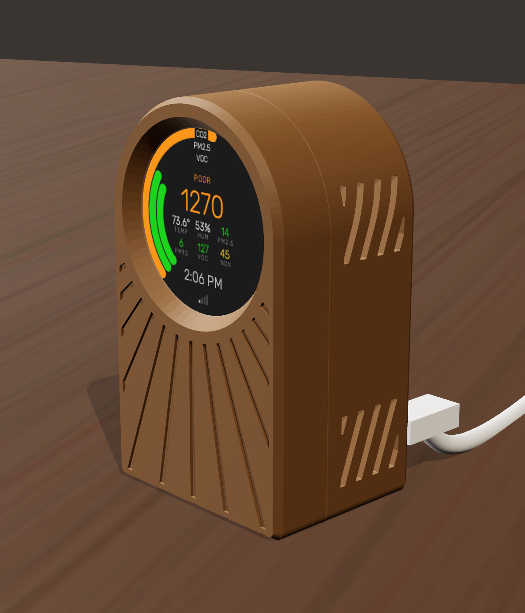
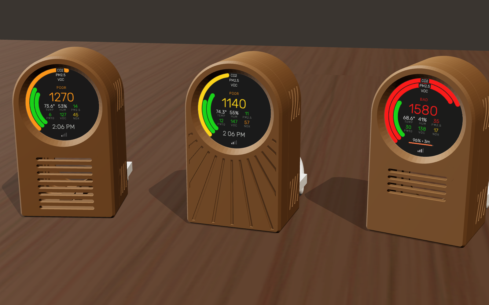

# SEN66 Air Quality Monitor: Adafruit round display + ESP32-C3 SuperMini

A variant of [doctormord's SEN6X_ESPHOME](https://github.com/doctormord/SEN6X_ESPHOME)
built for a desk next to a Prusa CORE One. The air-quality logic, theme engine,
anti-reset polling and humidity compensation are his work; this folder adapts it
to different hardware, reworks the screen layout, and adds a new case.



## What's different from the original

- **Hardware:** Adafruit 1.28" round display (6178) with backlight control, ESP32-C3 SuperMini, Adafruit SEN6x breakout (6331).
- **Screen:** three thick arcs with their names at 12 o'clock, a 3×2 metric grid, an overall status word (GOOD / MODERATE / POOR / BAD), loading spinner, signal bars.
- **Bottom line:** a clock (12/24-hour, blinking colon, adjustable brightness) that slides between print progress and time left from Home Assistant's PrusaLink entities while printing.
- **Settings in Home Assistant:** 10 color schemes with dark and light versions (Catppuccin, Dracula, Nord, Gruvbox, Solarized, Tokyo Night, Atom One, Rosé Pine, GitHub, Everforest), screen rotation, screen margin, and sleep hours (screen off at fixed times).
- **Units:** °F, with a °F calibration slider.
- **Optional button:** tap to show IP / Wi-Fi / uptime / build number for 30 s, hold 3 s to restart.
- **Desktop preview:** `aqs-preview.yaml` runs the same screen in a window on Linux/WSL with fake readings.
- **Case:** an "alarm clock" remix of his MakerWorld case with a round top, and three front designs (see [case/](case/)).

Full history: [CHANGELOG.md](CHANGELOG.md).



## Files

```
adafruit-supermini/
├── aqs-sen6x-c3.yaml      real device
├── aqs-preview.yaml       desktop preview with fake readings
├── common/aqs-ui.yaml     shared screen layout, colors, thresholds (edit this one)
├── CHANGELOG.md           firmware build history
├── case/                  STEP + STL files (CC BY-NC-SA 4.0)
└── secrets.yaml           you create this (not in the repo)
```

## Wiring

**Display (Adafruit 1.28" round) → SuperMini**

| Display | SuperMini |
|---|---|
| Vin | 3.3 |
| Gnd | G |
| SCK | 8 |
| MOSI | 10 |
| TFTCS | 5 |
| DC | 4 |
| RST | 3 |
| Lite (backlight) | 2 |

Leave MISO, SDCS and 3Vo unconnected.

**SEN6x breakout (STEMMA QT cable) → SuperMini**

| Wire | SuperMini |
|---|---|
| Red | 5V |
| Black | G |
| Blue (SDA) | 6 |
| Yellow (SCL) | 7 |

The SEN66 plugs into the breakout with a JST-GH 6-pin cable. The breakout has its
own regulator and I²C pull-ups, so it takes 5V.

**Optional button:** a 12 mm tactile switch between pad **1** and **G** (use two diagonal legs).

30 AWG wire fits the case well.

## One-time setup (Arch on WSL)

```bash
sudo pacman -S --needed python sdl2 base-devel
python -m venv ~/esphome-venv
source ~/esphome-venv/bin/activate
pip install esphome
```

Clone this repo into your Linux home (e.g. `git clone https://github.com/civarson/SEN6X_ESPHOME ~/esphome/SEN6X_ESPHOME`); the project is the `adafruit-supermini` folder.

## Make it yours

Everything personal is in the `substitutions:` block at the top of `aqs-sen6x-c3.yaml`:

- **Location** (`my_latitude`, `my_longitude`): used for sunrise/sunset dimming.
- **Time zone** (`my_timezone`): an IANA name such as `America/New_York` or `Europe/London` ([list](https://en.wikipedia.org/wiki/List_of_tz_database_time_zones)). Daylight saving is handled automatically.
- **Wi-Fi and keys:** in `secrets.yaml` (see below).
- **Your printer:** the three `printer_*_entity` lines (see next section).

### Your printer

The bottom line shows print progress by reading three sensors from Home Assistant.
The device doesn't talk to the printer itself, so any printer that Home Assistant
can see works:

| Substitution | What it needs | PrusaLink example |
|---|---|---|
| `printer_status_entity` | The printer's state (printing, paused, idle…) | `sensor.prusa_core_one` |
| `printer_progress_entity` | Progress in % | `sensor.prusa_core_one_progress` |
| `printer_finish_entity` | Estimated finish time (a timestamp) | `sensor.prusa_core_one_print_finish` |

1. In Home Assistant, open **Settings → Devices & services**, find your printer's
   integration and open the device. Click each sensor and copy its **entity ID**
   (cog icon → Entity ID).
2. Paste them into the three substitutions and flash.
3. Start a print to check it. If progress never appears, an entity ID is usually
   misspelled; `esphome logs aqs-sen6x-c3.yaml` shows what the device receives.

Progress shows while the status is `printing` or `paused`; `running` and `pause`
(Bambu Lab) are recognized too, and capitalization doesn't matter (OctoPrint uses
`Printing`). If your integration uses other words, add them in `common/aqs-ui.yaml`
where it says `bool printing =`. If the finish-time sensor is missing, the line just
shows the percentage.

**No printer?** Leave the substitutions as they are. Home Assistant reports them as
unknown, and the bottom line simply shows the clock.

### secrets.yaml

Copy the values from Home Assistant (`/config/esphome/secrets.yaml`).
`api_key` and `ota_key` **must match what's on the device now**, or Wi-Fi
flashing and the Home Assistant connection will fail.

```yaml
api_key: "..."
ota_key: "..."
wifi_legacy_ssid: "..."
wifi_password: "..."
wifi_ap_password: "..."
```

## Everyday use

```bash
source ~/esphome-venv/bin/activate
cd ~/esphome/SEN6X_ESPHOME/adafruit-supermini

esphome run aqs-preview.yaml     # opens a 240x240 preview window
esphome run aqs-sen6x-c3.yaml    # builds and flashes the device over Wi-Fi
```

When flashing, pick the device's network address (OTA) when asked.
The first build of each takes several minutes; later builds are quick.

## Preview notes

- The window is square; the real screen is round, so ignore the corners.
- Readings sweep from good to bad over 2 minutes so every color shows.
- Settings such as theme or arc assignments come from the `initial_option`
  and `initial_value` lines in `common/aqs-ui.yaml`. The preview remembers
  them between runs; to make it pick up edited defaults, delete its saved
  settings: `rm -f ~/.esphome/prefs/aqs-preview*` (path may vary; ESPHome
  prints it at startup).
- Backlight dimming is simulated as a log line.
- Press **N** to cycle through the color schemes and **M** to switch dark/light.
- Press **B** in the preview window to act as the button (tap = device info,
  hold 3 s = "Restarting", which the preview only pretends to do).

## Sleep hours

With **Sleep Schedule** on, the screen turns off from **Sleep Start** to **Sleep End**
(defaults 10:00 PM to 7:00 AM; overnight ranges work). Readings and Home Assistant
keep updating. A button tap lights the screen for 30 s. Outside those hours,
Brightness Day / Brightness Night apply as before (sunrise/sunset).

## Screen margin

**Screen Margin** (0–12 px, default 6) in Home Assistant pulls the three arcs in
from the edge so the case window doesn't hide them. The arcs get a little thinner
as the margin grows; the centre content stays put. About 7 px = 1 mm.

## Screen rotation

**Screen Rotation** (0°/90°/180°/270°) in the device's Home Assistant settings turns the
picture without reflashing and is remembered. `display_rotation` in
`aqs-sen6x-c3.yaml` only sets the starting value on a freshly flashed board.

## Button (optional)

Wire the 12 mm switch between **GPIO1** and **GND** (no resistor needed).

- **Tap:** the bottom line shows the IP address, Wi-Fi strength and uptime
  (6 s each) for 30 s, then goes back. Tap again to skip ahead.
- **Hold 3 s:** shows "Restarting" and reboots.

## Build number

`build_number` near the top of `common/aqs-ui.yaml` is the firmware build
(see CHANGELOG.md). Add 1 every time you change something and flash.
It shows in Home Assistant as the device's firmware version and as the
"Firmware Build" diagnostic entity (with the compile time), and on screen
as the last info item after a button tap.

## Credits and licenses

- **Firmware:** based on [doctormord/SEN6X_ESPHOME](https://github.com/doctormord/SEN6X_ESPHOME), which credits [tuct](https://github.com/tuct) for the original driver. Licensed under **GPL-3.0** (see [LICENSE](../LICENSE)); changes are listed in CHANGELOG.md.
- **Case:** remixed from doctormord's case on [MakerWorld](https://makerworld.com/models/2422805), licensed **CC BY-NC-SA 4.0**. See [case/LICENSE.md](case/LICENSE.md).
